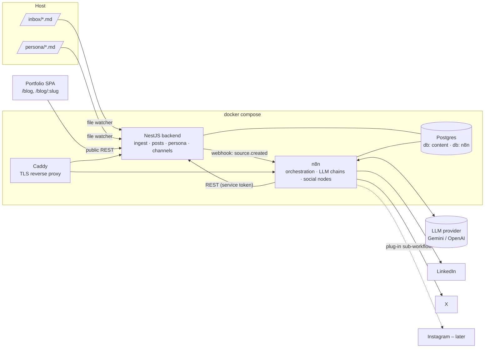

# Content Automation Engine — Implementation Plan (Draft)

> Status: **Draft for review** · Owner: callmehalpha · Last updated: 2026-10-12

## 1. Goal

Drop a Markdown file (commit history, messages, notes from any project) into a folder, and get:

1. A curated, on-brand **blog post** published to the portfolio (`abdulazeez.usaiy.xyz/blog/<slug>`).
2. A **summary + link** posted to **LinkedIn** and **X**.
3. Everything written in **my voice**, driven by a personality / personal-branding Markdown that I maintain.
4. New mediums (Instagram, Threads, Bluesky, dev.to, Medium, newsletter…) addable **without touching the core pipeline**.

All of it self-hosted and Dockerized: **n8n** (orchestration + LLM + social posting), **NestJS** (system of record + blog API), **Postgres**.

---

## 2. Architecture



### Division of responsibility (the key design decision)

| Concern | Owner | Why |
|---|---|---|
| Watching `inbox/` + `persona/`, dedupe, storing raw docs | **NestJS** | n8n 2.x disables the Local File Trigger by default, and inotify is unreliable on Docker bind mounts (macOS/Windows). A NestJS watcher with polling + content hashing is deterministic and testable. It also lets other sources (CI, a CLI, a GitHub Action) push docs via `POST /api/ingest`. |
| State: posts, statuses, publications, idempotency | **NestJS + Postgres** | One source of truth. n8n executions are ephemeral; we never want to double-post because a workflow was retried. |
| Public blog API for the portfolio | **NestJS** | Stable, cacheable, versioned API independent of n8n. |
| LLM prompting, chaining, provider choice | **n8n** | Swapping Gemini ↔ OpenAI (or anything else) is replacing one Chat Model sub-node. Prompts are visible/editable without redeploys. |
| Social OAuth + posting | **n8n** | n8n's credential store handles OAuth2 flows/refresh for LinkedIn and X; built-in nodes exist for both. |
| Per-channel formatting rules | **Postgres (`channels.config`) + n8n sub-workflow per channel** | This is the extensibility seam — see §7. |

Rule of thumb: **NestJS knows *what* exists and *what happened*; n8n knows *how* to do it.**

---

## 3. Repository layout

Proposed: a new top-level `content-engine/` folder in this repo (keeps the blog API contract next to the frontend that consumes it). It can be split into its own repo later with no code changes.

```
content-engine/
├── docker-compose.yml
├── docker-compose.override.example.yml   # local dev tweaks (ports, hot reload)
├── .env.example
├── Caddyfile
├── inbox/                 # drop *.md here  (gitignored)
│   ├── processed/
│   └── failed/
├── persona/               # personality.md, branding-plan.md (gitignored or private)
├── backend/               # NestJS app
│   ├── Dockerfile
│   ├── prisma/schema.prisma
│   └── src/
│       ├── ingest/        # watcher + POST /api/ingest
│       ├── persona/       # versions + distilled style guide
│       ├── posts/         # public + internal endpoints
│       ├── channels/      # registry of mediums
│       ├── publications/  # per-channel results, idempotency
│       ├── pipeline/      # n8n webhook client, run tracking
│       ├── auth/          # service-token + admin guards
│       └── health/
├── n8n/
│   ├── workflows/         # exported JSON, version-controlled
│   └── README.md          # import/export instructions
└── scripts/
    ├── export-commits.sh  # generate an inbox md from any git repo
    └── backup-db.sh
```

---

## 4. Docker setup

### Services

| Service | Image | Exposed | Notes |
|---|---|---|---|
| `postgres` | `postgres:16-alpine` | internal only | Two databases: `content` (NestJS) and `n8n`. Separate DB users. Init script creates both. Volume `pgdata`. |
| `n8n` | `n8nio/n8n:<pinned>` | via Caddy (`n8n.<domain>`) | `DB_TYPE=postgresdb`, `N8N_ENCRYPTION_KEY` (**persist & back up — losing it bricks all saved credentials**), `WEBHOOK_URL`, `N8N_EDITOR_BASE_URL`, `GENERIC_TIMEZONE`, `N8N_RUNNERS_ENABLED=true`. Volume `n8n_data`. Public HTTPS is required for LinkedIn/X OAuth callbacks. |
| `backend` | built from `backend/Dockerfile` (multi-stage, `node:22-alpine`, non-root) | via Caddy (`api.<domain>`) | Mounts `./inbox` and `./persona`. Runs `prisma migrate deploy` on start. Healthcheck `GET /health`. |
| `caddy` | `caddy:2-alpine` | 80/443 | Auto TLS. Restrict n8n editor (IP allowlist or basic auth) while leaving `/webhook*` and `/rest/oauth2-credential/callback` reachable. |

All services on one internal network; `depends_on` with `condition: service_healthy`. n8n calls the backend at `http://backend:3000` internally; the backend calls n8n at `http://n8n:5678/webhook/...`.

### Environment (`.env.example`)

```
DOMAIN=usaiy.xyz
POSTGRES_PASSWORD=
CONTENT_DB_PASSWORD=
N8N_DB_PASSWORD=
N8N_ENCRYPTION_KEY=
INTERNAL_SERVICE_TOKEN=        # n8n -> backend bearer token
N8N_PIPELINE_WEBHOOK_URL=http://n8n:5678/webhook/pipeline/source-created
N8N_WEBHOOK_SECRET=            # backend -> n8n header secret
ADMIN_TOKEN=                   # approve/reject endpoints
PUBLIC_SITE_URL=https://abdulazeez.usaiy.xyz
AUTO_PUBLISH=false             # human approval gate, see §6
WATCH_POLL_INTERVAL_MS=5000
```

LLM and social API keys live **only in n8n credentials**, not in the backend.

---

## 5. Backend (NestJS) design

### Stack

- NestJS 11, TypeScript, **Prisma** (migrations + typed client), `class-validator` DTOs, `@nestjs/throttler`, `chokidar` (with `usePolling: true`), `pino` logging, `@nestjs/terminus` health.
- Markdown kept as Markdown in the DB; rendered on the frontend with a sanitizer (LLM output is untrusted HTML-wise).

### Data model

```prisma
enum SourceStatus   { RECEIVED PROCESSING DONE FAILED SKIPPED }
enum PostStatus     { DRAFT PENDING_APPROVAL APPROVED PUBLISHED REJECTED }
enum PubStatus      { PENDING PUBLISHED FAILED SKIPPED }
enum PersonaKind    { PERSONALITY BRANDING }

model SourceDocument {
  id          String       @id @default(cuid())
  filename    String
  contentHash String       @unique          // sha256 -> dedupe re-drops
  project     String?                       // from frontmatter
  frontmatter Json?
  rawMarkdown String
  status      SourceStatus @default(RECEIVED)
  error       String?
  receivedAt  DateTime     @default(now())
  posts       Post[]
  runs        PipelineRun[]
}

model PersonaDocument {
  id          String      @id @default(cuid())
  kind        PersonaKind
  version     Int
  content     String
  distilled   Json?       // structured style guide produced by the persona agent
  active      Boolean     @default(false)
  createdAt   DateTime    @default(now())
  @@unique([kind, version])
}

model Post {
  id             String     @id @default(cuid())
  sourceId       String
  source         SourceDocument @relation(fields: [sourceId], references: [id])
  slug           String     @unique
  title          String
  excerpt        String
  bodyMarkdown   String
  tags           String[]
  coverImageUrl  String?
  seo            Json?      // title, description, og image
  llmMeta        Json?      // model, prompt versions, token usage, persona versions
  status         PostStatus @default(DRAFT)
  publishedAt    DateTime?
  createdAt      DateTime   @default(now())
  updatedAt      DateTime   @updatedAt
  publications   Publication[]
}

model Channel {
  id        String   @id @default(cuid())
  key       String   @unique     // "linkedin" | "x" | "instagram" ...
  name      String
  enabled   Boolean  @default(false)
  workflow  String               // n8n sub-workflow name/id, e.g. "publish.linkedin"
  config    Json                 // see §7: maxLength, requiresMedia, hashtags, tone, linkPlacement...
  publications Publication[]
}

model Publication {
  id          String    @id @default(cuid())
  postId      String
  channelId   String
  post        Post      @relation(fields: [postId], references: [id])
  channel     Channel   @relation(fields: [channelId], references: [id])
  content     String               // the exact text posted
  mediaUrls   String[]
  status      PubStatus @default(PENDING)
  externalId  String?
  externalUrl String?
  attempts    Int       @default(0)
  lastError   String?
  publishedAt DateTime?
  @@unique([postId, channelId])    // idempotency: one post per channel, ever
}

model PipelineRun {
  id             String   @id @default(cuid())
  sourceId       String
  source         SourceDocument @relation(fields: [sourceId], references: [id])
  n8nExecutionId String?
  stage          String           // analyze | draft | review | publish_blog | fanout
  status         String
  meta           Json?
  startedAt      DateTime @default(now())
  finishedAt     DateTime?
}
```

### API surface

**Public** (no auth, throttled, cache headers):

| Method | Path | Purpose |
|---|---|---|
| GET | `/api/posts?page=&tag=` | Published posts list (title, slug, excerpt, date, tags) |
| GET | `/api/posts/:slug` | Full post |
| GET | `/api/feed.xml` | RSS |
| GET | `/api/sitemap-posts.xml` | For SEO |

**Internal** (n8n only, `Authorization: Bearer $INTERNAL_SERVICE_TOKEN`):

| Method | Path | Purpose |
|---|---|---|
| POST | `/api/ingest` | Upload a markdown doc (alternative to the folder; used by CI/scripts) |
| GET | `/internal/sources/:id` | Raw doc + frontmatter |
| PATCH | `/internal/sources/:id` | Status / error |
| GET | `/internal/persona/context` | Active personality + branding (raw + distilled) |
| PUT | `/internal/persona/:id/distilled` | Store distilled style guide |
| GET | `/internal/posts/recent?limit=10` | Recent titles/slugs — avoid repetition, enable interlinking |
| POST | `/internal/posts` | Create draft (validates slug uniqueness, auto-suffixes) |
| PATCH | `/internal/posts/:id` | Status transitions (state machine enforced server-side) |
| GET | `/internal/channels?enabled=true` | Channel registry for fan-out |
| POST | `/internal/publications/claim` | Claim `(postId, channelId)`; returns 409 if already published → idempotency |
| PATCH | `/internal/publications/:id` | Record result (externalUrl, error) |
| POST | `/internal/runs` / PATCH `/internal/runs/:id` | Run tracking |

**Admin** (`ADMIN_TOKEN`): `GET /admin/posts?status=`, `POST /admin/posts/:id/approve|reject`, `PATCH /admin/posts/:id` (edit before approve), `POST /admin/sources/:id/retry`, `PATCH /admin/channels/:key`.

### Ingest flow (backend)

1. Watcher sees `inbox/foo.md` → waits for write to settle (`awaitWriteFinish`).
2. Parse frontmatter (`gray-matter`), compute sha256. Duplicate hash → move to `processed/` and mark `SKIPPED`.
3. Insert `SourceDocument`, move file to `inbox/processed/<date>-foo.md`.
4. `POST` n8n webhook `{ sourceId }` with secret header. On failure: retry with backoff; a cron sweeps `RECEIVED` docs older than N minutes and re-triggers.

Same pattern for `persona/`: a changed file creates a new `PersonaDocument` version, marks it active, and triggers the persona-distill workflow.

---

## 6. n8n workflows

All exported to `content-engine/n8n/workflows/*.json` and committed. Credentials are never exported.

### WF-00 `persona.distill` — the personality agent

Trigger: webhook from backend when `persona/*.md` changes.

1. GET persona context.
2. LLM (structured output) turns raw personality + branding plan into a **style guide JSON**:
   ```json
   {
     "voice": ["direct", "systems-thinking", "pragmatic"],
     "audience": ["engineering leads", "founders"],
     "contentPillars": ["architecture decisions", "shipping under constraints", "..."],
     "do": ["lead with the problem", "use concrete numbers"],
     "dont": ["hype words", "emoji spam", "'game-changer'"],
     "signaturePhrases": [],
     "ctaStyle": "soft, invite discussion",
     "perChannel": { "linkedin": {...}, "x": {...} }
   }
   ```
3. PUT distilled result to backend.

Every generation step gets **both** the distilled guide (concise, reliable) and the raw docs (nuance). Persona versions used are stored in `post.llmMeta` so you can see which version wrote what.

### WF-01 `pipeline.source-created` — main pipeline

```
Webhook(sourceId)
 → GET source + persona context + recent posts
 → [LLM-1 Analyze]   extract: project, timeframe, what was built, problems, decisions,
                     trade-offs, metrics, lessons, "blogWorthy" score + reason
 → IF not blogWorthy → PATCH source SKIPPED, notify, stop
 → [LLM-2 Outline]   angle/hook selection against content pillars, outline
 → [LLM-3 Draft]     structured output: { title, slug, excerpt, bodyMarkdown, tags, seo }
 → [LLM-4 Review]    critique vs persona do/don't + factual grounding against source
                     (no invented metrics/claims) → revised draft
 → POST /internal/posts (DRAFT)
 → IF AUTO_PUBLISH → WF-02
   ELSE → set PENDING_APPROVAL, send notification (email/Telegram) with
          preview + approve/reject links → Wait node (resume on webhook)
 → on approve → WF-02
```

Every LLM step uses n8n's **Structured Output Parser** with a JSON schema, so downstream nodes never parse free text. The Chat Model sub-node is the only provider-specific piece.

### WF-02 `pipeline.publish` — blog + fan-out

```
PATCH post → PUBLISHED  (backend returns canonical URL)
 → GET /internal/channels?enabled=true
 → Loop over channels:
     POST /publications/claim  (409 → skip, already posted)
     [LLM-5 Channel copy]  input: post, persona.perChannel[key], channel.config
                           output: { text, hashtags, mediaPrompt? }
     Validate length/rules (Code node using channel.config)
     Execute Workflow  channel.workflow   ← the plug-in point
     PATCH publication with result
 → Summary notification (links to blog + each social post)
```

Channel failures are isolated: one failing channel doesn't block the others; it's marked `FAILED` and retryable from admin.

### WF-1x `publish.<channel>` — one sub-workflow per medium

Uniform contract (Execute Workflow Trigger input/output):

```jsonc
// input
{ "publicationId": "…", "postUrl": "https://…/blog/slug", "text": "…",
  "hashtags": ["…"], "mediaUrls": [], "config": { /* channel.config */ } }
// output
{ "ok": true, "externalId": "…", "externalUrl": "…", "error": null }
```

- `publish.linkedin` — LinkedIn node (OAuth2, `w_member_social`), post as person, link as article share.
- `publish.x` — X node (OAuth2). Link in the main tweet or as a reply depending on `config.linkPlacement` (link-in-reply often reaches further).

### WF-90 `system.error`

Set as the error workflow for all others: PATCH run/source `FAILED` with message, notify.

### Prompt management

Prompts live in n8n nodes initially. Once stable, move them to a `prompts` table (or files in repo) with versions, fetched at runtime, so prompt changes are tracked in git/DB and recorded in `llmMeta`.

---

## 7. Adding a new medium (extensibility contract)

Adding Instagram (or anything) should be **three steps, zero core changes**:

1. **Insert a channel row**
   ```json
   { "key": "instagram", "name": "Instagram", "enabled": true,
     "workflow": "publish.instagram",
     "config": { "maxLength": 2200, "requiresMedia": true, "mediaKind": "image",
                 "linkPlacement": "bio", "hashtags": { "min": 3, "max": 10 },
                 "tone": "visual, casual" } }
   ```
2. **Create `publish.instagram` sub-workflow** honouring the contract in §6.
3. **(Optional) add `perChannel.instagram` to the persona** branding doc.

Capabilities in `config` drive the generic steps: `requiresMedia: true` makes WF-02 run a media step first (generate a quote card / cover image via an image model or an HTML-to-image template, upload to backend storage, pass `mediaUrls`). This matters because Instagram has no text-only posts and no clickable links in captions — exactly the kind of difference that would otherwise leak into the core pipeline.

Same pattern later covers Threads, Bluesky, Mastodon, dev.to / Hashnode / Medium (cross-post with canonical URL), and a newsletter.

---

## 8. Portfolio (this repo's frontend) changes

Today build logs are hard-coded in `src/data/constants.tsx` (`BUILD_LOGS`) and link out to LinkedIn.

1. `src/lib/api.ts` — typed client for `/api/posts` (`VITE_CONTENT_API_URL`).
2. Routes `/blog` and `/blog/:slug` in `src/App.tsx` (lazy-loaded like existing pages).
3. `BlogPost` page rendering Markdown with `react-markdown` + `rehype-sanitize` + code highlighting.
4. Portfolio "Build Logs" section fetches the latest 3 published posts (fall back to static `BUILD_LOGS` if the API is down), `BuildLogEntry` links to `/blog/:slug`.
5. `server.mjs` — extend the SEO injection: for `/blog/:slug`, fetch the post's SEO fields from the API (short in-memory cache) so LinkedIn/X link previews show the correct title/description/OG image.
6. Sitemap: reference the API's `sitemap-posts.xml` from `public/robots.txt` or generate a sitemap index.

---

## 9. Input Markdown convention

Frontmatter is optional but improves output a lot:

```markdown
---
project: Atlax Exchange
repo: github.com/callmehalpha/atlax
period: 2026-09-01..2026-09-30
audience: engineers            # engineers | founders | general
angle: "how we cut settlement latency"   # optional hint
channels: [linkedin, x]        # optional override of enabled channels
publish: true                  # false = draft only
---

## Commits
- 3f2a1c feat(settlement): batch ledger writes …
- …

## Notes
Why we did it, what broke, numbers…
```

`scripts/export-commits.sh <repo-path> --since "2 weeks ago"` generates this skeleton from `git log` (subjects, bodies, diffstat summary), so dropping a file is one command. Later: a reusable GitHub Action in each project that `POST`s to `/api/ingest` on release.

---

## 10. Security & reliability

- **Secrets**: `.env` gitignored; LLM/social keys only in n8n's encrypted credential store; back up `N8N_ENCRYPTION_KEY` separately from the DB.
- **Network**: Postgres not published; n8n editor behind auth/IP allowlist; internal endpoints require service token; admin endpoints separate token.
- **Untrusted text**: commit messages and LLM output are data, not instructions — prompts wrap source content in clear delimiters and the review step checks claims against the source; frontend sanitizes rendered Markdown.
- **Idempotency**: unique `(postId, channelId)` + claim endpoint → retries never double-post.
- **Retries**: n8n node-level retry with backoff on HTTP/social nodes; backend sweeper re-triggers stuck sources.
- **Backups**: nightly `pg_dump` of both DBs + `n8n/workflows` export to git.
- **Observability**: `PipelineRun` table + n8n execution IDs; notification on every success/failure.

---

## 11. Known platform constraints / risks

| Risk | Impact | Mitigation |
|---|---|---|
| LinkedIn member access tokens expire (~60 days) and non-partner apps typically don't get refresh tokens | Posting silently breaks every ~2 months | Track token expiry, reminder notification at T-7 days; re-auth in n8n credentials. |
| X API write access depends on paid/free tier limits, which change frequently | Posts rejected / rate-limited | Verify current tier & monthly write limits before Phase 5; publication records make failures visible and retryable. |
| Instagram requires a Business/Creator account linked to a Facebook Page, an image for every post, and Meta app review | Can't be text-only | Channel `requiresMedia` + media step (§7). |
| LLM hallucinating metrics/claims about my projects | Reputation | Grounding review step (LLM-4), human approval gate on by default, `llmMeta` audit trail. |
| Repetitive or off-brand content over time | Weak brand | Recent-posts context, persona distillation, periodic prompt review. |
| n8n major upgrades changing node behaviour | Broken workflows | Pin image tag; upgrade deliberately with exported workflows as rollback. |

---

## 12. LLM provider decision (open)

The design keeps this swappable, so it doesn't block anything. Recommended way to decide:

1. Assemble 3–5 real inbox docs + the persona docs.
2. Run WF-01 with each candidate model (e.g. one Gemini model, one OpenAI model) by swapping the Chat Model sub-node.
3. Judge on: voice match, factual grounding, structured-output reliability, cost per post, latency.

Optionally use a cheaper/faster model for Analyze + Channel copy and a stronger one for Draft + Review.

---

## 13. Phased delivery

| Phase | Scope | Exit criteria |
|---|---|---|
| **0. Prep** | Pick VPS + subdomains (`api.`, `n8n.`), create LinkedIn developer app (Share on LinkedIn / `w_member_social`), X developer project, LLM API key(s). Write first persona + branding md. | Accounts & keys in hand |
| **1. Infra skeleton** | `docker-compose.yml`, Postgres init (2 DBs), n8n on Postgres, NestJS hello + `/health`, Caddy TLS | `docker compose up` → all healthy, n8n editor reachable over HTTPS |
| **2. Backend core** | Prisma schema + migrations, ingest watcher + `/api/ingest`, persona versions, posts/channels/publications internal API, public posts API, auth guards, seed channels (linkedin, x disabled) | Dropping a file creates a `SourceDocument` and hits a test n8n webhook; e2e tests green |
| **3. Portfolio blog** | `/blog`, `/blog/:slug`, Build Logs fed by API, `server.mjs` SEO for posts, sitemap | A seeded post renders with correct OG preview |
| **4. Generation** | WF-00 persona distill, WF-01 pipeline, approval via notification + Wait node, WF-90 error | Drop file → draft post with good quality → approve → visible on blog |
| **5. Social** | WF-02 fan-out, `publish.linkedin`, `publish.x`, idempotent claims, summary notification | End-to-end: drop file → blog + LinkedIn + X with links; retry doesn't double-post |
| **6. Hardening** | Backups, token-expiry reminders, sweeper, rate limits, prompt versioning, `export-commits.sh`, docs | One week of real use without manual DB fixes |
| **7. Extensibility proof** | `publish.instagram` + media generation step | Instagram added with no changes to WF-01/WF-02 or backend code |

---

## 14. Decisions needed from me

1. **LLM provider** — defer to the Phase 4 bake-off (§12), or pick now?
2. **Approval gate** — keep human approval on by default (recommended) or fully automatic?
3. **Notification channel** for approvals/failures — email, Telegram, or Slack?
4. **Hosting** — same VPS as the portfolio, or separate?
5. **Repo** — `content-engine/` inside this repo (proposed) or a dedicated repo?
6. **Persona docs** — commit to a private repo, or keep only on the server?
