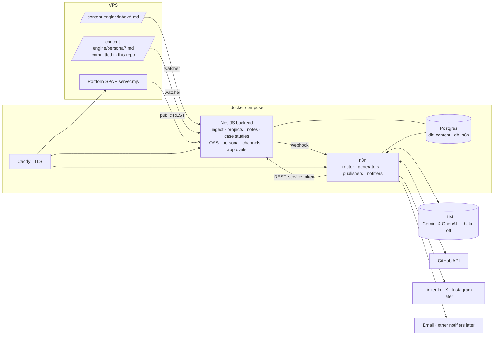

# Content Automation Engine — Implementation Plan (Draft v2)

> Status: **Phases 1–2 implemented** (see [`content-engine/README.md`](../content-engine/README.md)); phases 3+ planned · Owner: callmehalpha · Last updated: 2026-10-12
>
> v2 changes: decisions recorded (§14), the engine now feeds **three portfolio sections** (Technical Notes, Technical Case Studies, Open Source Projects), the Products section is retired, approval is a runtime toggle, and notifications are pluggable like publishing channels.
>
> v4 changes: SMTP comes from `.env` and the **backend sends email** (Mailpit for local testing); branding plan committed (`content-engine/persona/branding-plan.md`); positioning set to **Technical Product Builder**; first CV reconciliation done (`content-engine/seed/profile-v1-review.md`); resume variants start with **backend** and **full-stack**.
>
> v3 changes: **CV ingest** builds a structured, versioned **Profile** that drives the hero, capabilities, a new Experience section and SEO, positioned to sell me (§3.1, WF-06). Visitors can **download a resume generated on the server** from all approved data (§6.7, WF-07). Approval email address recorded (D10).

## 1. Goal

Drop a Markdown file (commit history, messages, notes from any project) into a folder, and the engine keeps the portfolio and socials current on its own:

| Portfolio section | What the engine does | Today |
|---|---|---|
| **Technical Notes** (`#build-logs`) | Writes a note (blog post) in my voice, hosted on the portfolio at `/notes/<slug>` | One hard-coded entry in `BUILD_LOGS` that links out to LinkedIn |
| **Technical Case Studies** (`#case-studies`) | Keeps a **living case study per project**, creating it for new projects and merging new work into existing ones | Five hard-coded entries in `CASE_STUDIES` |
| **Open Source Projects** (replaces `#products`) | Keeps an entry per open-source project I build or contribute to, with my contributions and live GitHub stats | Products section with the AI Job Hunter Kit |
| **LinkedIn, X (later Instagram, …)** | Posts a summary + link for each published note | Manual |
| **Hero, Capabilities, Experience, SEO** | Builds them from my **CV + everything else in the system**, written to position me for the roles and clients I want | Hard-coded copy in `Portfolio.tsx` / `constants.tsx`; no Experience section |
| **Resume download** | Generates an up-to-date PDF resume on the server from all approved data, re-built whenever that data changes | None |

The overall goal: **sell me and grow my personal brand.** Every generator gets the branding plan as its brief, and the portfolio, the resume and the social posts all tell one consistent story.

Everything is written from a personality / personal-branding Markdown I maintain, goes through **my approval by default** (toggleable), and notifies me by **email** (other notifiers pluggable later).

Stack, all Dockerized on the **same VPS as the portfolio**: **n8n** (orchestration + LLM + social posting), **NestJS** (system of record + content API), **Postgres**.

---

## 2. Architecture



### Division of responsibility

| Concern | Owner | Why |
|---|---|---|
| Watching `inbox/` + `persona/`, dedupe, storing raw docs | **NestJS** | n8n 2.x disables the Local File Trigger by default, and inotify is unreliable on Docker bind mounts. A NestJS watcher with polling + content hashing is deterministic and testable, and `POST /api/ingest` lets CI or scripts push docs too. |
| State: projects, notes, case studies, OSS entries, approvals, publications | **NestJS + Postgres** | One source of truth. n8n executions are ephemeral; retries must never double-post or double-update. |
| Public content API for the portfolio | **NestJS** | Stable, cacheable API independent of n8n. |
| Routing, LLM prompting, provider choice | **n8n** | Swapping Gemini ↔ OpenAI is replacing one Chat Model sub-node, which is what the bake-off needs. Prompts are editable without redeploys. |
| Social + email delivery | **n8n** | Credential store handles OAuth2 for LinkedIn/X and SMTP for email; built-in nodes exist. |
| Per-channel / per-notifier rules | **Postgres registry + one n8n sub-workflow each** | The extensibility seam — see §7. |

Rule of thumb: **NestJS knows *what* exists and *what happened*; n8n knows *how* to do it.**

---

## 3. Content model: one inbox, many outputs

The key change in v2: a dropped file is no longer "a blog post request". It is **new information about a project**, and a router decides which outputs it should update.

```
                         ┌─► Note (Technical Notes)      ──► Social fan-out
inbox/*.md ─► Router ────┼─► Case study update (per project)
                         └─► OSS entry update (per OSS project)
```

### Projects are first-class

Every source doc belongs to a **Project** (`project:` slug in frontmatter, or inferred by the router and confirmed in the approval email). A project has a `kind`:

- `client` / `product` — private or commercial work → gets a **case study**.
- `oss` — open source I author or contribute to → gets an **OSS entry**.

### Routing rules (defaults, overridable per file via frontmatter `outputs:`)

| Doc about… | Note | Case study | OSS entry | Social |
|---|---|---|---|---|
| A `client`/`product` project | if blog-worthy | **always** (create or merge) | — | with the note |
| An `oss` project | if blog-worthy | — | **always** (create or merge) | with the note |
| No clear project (an idea, a lesson) | if blog-worthy | — | — | with the note |

"Blog-worthy" is an LLM judgement with a reason, shown in the approval email so I can override it.

### 3.1 The CV and the Profile

A CV is a different kind of input: it's not about one project, it's about **me**. It goes into `inbox/cv/` (PDF, DOCX or Markdown) and produces a **Profile**, a single structured, versioned record of who I am professionally:

- headline, positioning statement, summary, location, availability
- experience (company, title, dates, location, impact bullets, linked projects)
- skills (grouped by category, with the ones to lead with flagged)
- education, certifications, awards, languages, links
- headline stats ("8+ production platforms") with the evidence behind each

The Profile is built from the CV and then **cross-checked against everything else in the system**: case studies, OSS entries and notes. So:

- A role in the CV with no case study → a **draft case study is proposed** for that project.
- A case study or OSS contribution that isn't reflected in the CV → its strongest points are proposed as experience bullets.
- Stats are only shown when something in the system backs them up.

Then a **positioning pass** rewrites the headline, summary and bullets against the branding plan: impact first, quantified where the sources allow, aimed at the audience in the branding plan. It never adds employers, titles, dates or numbers that aren't in a source. Every Profile revision goes through approval with a field-by-field diff, like case studies.

The approved Profile drives the hero, Capabilities, a new **Experience** section, structured data for SEO, and the resume.

---

## 4. Repository layout

`content-engine/` lives in this repo (private). Persona docs are committed here too; the inbox is not.

```
content-engine/
├── docker-compose.yml
├── docker-compose.override.example.yml   # local dev tweaks
├── .env.example
├── Caddyfile
├── inbox/                 # drop *.md here (gitignored)
│   ├── cv/                # drop CV here: .pdf | .docx | .md
│   ├── processed/
│   └── failed/
├── storage/               # generated resumes, uploaded CVs (gitignored, volume)
├── persona/               # committed: branding-plan.md (done), personality.md (to write)
├── seed/                  # one-off import of current CASE_STUDIES / BUILD_LOGS + profile-v1-review.md
├── backend/               # NestJS app
│   ├── Dockerfile
│   ├── prisma/schema.prisma
│   └── src/
│       ├── ingest/        # watcher + POST /api/ingest
│       ├── persona/       # versions + distilled style guide
│       ├── projects/
│       ├── notes/         # Technical Notes
│       ├── case-studies/  # living case studies + revisions
│       ├── oss/           # Open Source Projects + contributions
│       ├── profile/       # CV parsing, versioned Profile
│       ├── resume/        # resume templates, PDF rendering, download endpoint
│       ├── approvals/     # generic approval items + signed links
│       ├── settings/      # runtime toggles (approval gate, …)
│       ├── channels/      # publishing mediums registry
│       ├── notifiers/     # notification mediums registry
│       ├── publications/  # per-channel results, idempotency
│       ├── pipeline/      # n8n webhook client, run tracking
│       ├── auth/          # service-token + admin guards
│       └── health/
├── n8n/
│   ├── workflows/         # exported JSON, version-controlled
│   └── README.md
└── scripts/
    ├── export-commits.sh  # generate an inbox md from any git repo
    └── backup-db.sh
```

On the server, `git pull` updates `persona/`; the watcher picks up the change and re-runs persona distillation.

---

## 5. Docker setup

Same VPS as the portfolio. Caddy fronts everything, so the existing `node server.mjs` either moves behind Caddy as a fourth service (`portfolio`) or stays as-is with Caddy proxying to it.

| Service | Image | Exposed | Notes |
|---|---|---|---|
| `postgres` | `postgres:17-alpine` (n8n 2.x needs 17+) | internal only | Two databases: `content` (NestJS) and `n8n`, separate users. Volume `pgdata`. |
| `n8n` | `n8nio/n8n:<pinned>` | `n8n.<domain>` via Caddy | `DB_TYPE=postgresdb`, `N8N_ENCRYPTION_KEY` (**persist & back up — losing it bricks all saved credentials**), `WEBHOOK_URL`, `N8N_EDITOR_BASE_URL`, `GENERIC_TIMEZONE`, `N8N_RUNNERS_ENABLED=true`. Volume `n8n_data`. Public HTTPS is needed for LinkedIn/X OAuth callbacks. |
| `backend` | `backend/Dockerfile` (multi-stage, `node:22-alpine`, non-root) | `api.<domain>` via Caddy | Mounts `./inbox` and `./persona`. Runs `prisma migrate deploy` on start. Healthcheck `GET /health`. |
| `gotenberg` | `gotenberg/gotenberg:8` | internal only | HTML → PDF with headless Chromium for the resume. Kept in its own container so Chromium stays out of the backend image and is isolated. |
| `mailpit` *(dev only, in `docker-compose.override.yml`)* | `axllent/mailpit` | UI on `localhost:8025` | Catches every email locally (SMTP on `mailpit:1025`), so approval emails, links and resume attachments can be tested without sending real mail. |
| `caddy` | `caddy:2-alpine` | 80/443 | Auto TLS. n8n editor behind basic auth / IP allowlist; `/webhook*` and OAuth callback stay reachable. Approval links hit the **backend**, not n8n. |
| `portfolio` *(optional)* | built from repo root | `abdulazeez.usaiy.xyz` | Runs existing `npm run build && node server.mjs`. |

### Environment (`.env.example`)

```
DOMAIN=usaiy.xyz
POSTGRES_PASSWORD=
CONTENT_DB_PASSWORD=
N8N_DB_PASSWORD=
N8N_ENCRYPTION_KEY=
INTERNAL_SERVICE_TOKEN=        # n8n -> backend bearer token
N8N_WEBHOOK_BASE=http://n8n:5678/webhook
N8N_WEBHOOK_SECRET=            # backend -> n8n header secret
ADMIN_TOKEN=                   # admin endpoints
APPROVAL_LINK_SECRET=          # HMAC for one-click approve/reject links
PUBLIC_SITE_URL=https://abdulazeez.usaiy.xyz
PUBLIC_API_URL=https://api.usaiy.xyz
WATCH_POLL_INTERVAL_MS=5000
GOTENBERG_URL=http://gotenberg:3000
STORAGE_DIR=/data/storage

# Email (production: your SMTP credentials; dev: Mailpit)
SMTP_HOST=mailpit
SMTP_PORT=1025
SMTP_SECURE=false
SMTP_USER=
SMTP_PASS=
MAIL_FROM="Callmehalpha Content Engine <no-reply@usaiy.xyz>"
```

The approval email address is set on the `email` notifier row (`config.to`), not in env, so it can change at runtime.

**Who sends email:** the backend, using `nodemailer` and the `SMTP_*` values above. Email HTML templates (approval, diff, failure, resume preview with the PDF attached) live in code next to the data they render, and SMTP credentials sit in `.env` with everything else. The n8n `notify.email` sub-workflow just calls `POST /internal/notify/email`. Other notifiers (Telegram, Slack) can still be pure n8n sub-workflows; the registry doesn't care which side sends.

The approval gate is **not** an env var any more — it's a runtime setting (§6.4). LLM, GitHub and social credentials live only in n8n; SMTP lives in `.env` for the backend.

---

## 6. Backend (NestJS) design

### 6.1 Stack

NestJS 11, TypeScript, **Prisma**, `class-validator` + `zod` (Profile JSON validation), `@nestjs/throttler`, `chokidar` (`usePolling: true`), `gray-matter`, `pdf-parse` / `mammoth` (CV text extraction from PDF / DOCX), `handlebars` (resume templates), `pino`, `@nestjs/terminus`. Markdown stored as Markdown; rendered and sanitized on the frontend.

### 6.2 Data model

```prisma
enum SourceStatus   { RECEIVED PROCESSING DONE FAILED SKIPPED }
enum ContentStatus  { DRAFT PENDING_APPROVAL APPROVED PUBLISHED REJECTED }
enum PubStatus      { PENDING PUBLISHED FAILED SKIPPED }
enum PersonaKind    { PERSONALITY BRANDING }
enum ProjectKind    { CLIENT PRODUCT OSS }
enum OssRole        { AUTHOR MAINTAINER CONTRIBUTOR }

model SourceDocument {
  id          String       @id @default(cuid())
  filename    String
  contentHash String       @unique          // sha256 -> dedupe re-drops
  projectId   String?
  project     Project?     @relation(fields: [projectId], references: [id])
  frontmatter Json?
  rawMarkdown String
  routing     Json?                          // router decision + reasons
  status      SourceStatus @default(RECEIVED)
  error       String?
  receivedAt  DateTime     @default(now())
  notes       Note[]
  runs        PipelineRun[]
}

model Project {
  id        String      @id @default(cuid())
  slug      String      @unique              // "atlax-exchange"
  name      String
  kind      ProjectKind
  url       String?
  repoUrl   String?
  visible   Boolean     @default(true)
  sortOrder Int         @default(0)          // order on the portfolio
  sources   SourceDocument[]
  caseStudy CaseStudy?
  oss       OssProject?
  notes     Note[]
}

model PersonaDocument {
  id        String      @id @default(cuid())
  kind      PersonaKind
  version   Int
  content   String
  distilled Json?
  active    Boolean     @default(false)
  createdAt DateTime    @default(now())
  @@unique([kind, version])
}

// ── Technical Notes ─────────────────────────────────────────────
model Note {
  id            String        @id @default(cuid())
  sourceId      String?                      // null for seeded notes
  source        SourceDocument? @relation(fields: [sourceId], references: [id])
  projectId     String?
  project       Project?      @relation(fields: [projectId], references: [id])
  slug          String        @unique
  title         String
  excerpt       String
  bodyMarkdown  String
  tags          String[]
  coverImageUrl String?
  seo           Json?
  llmMeta       Json?                        // models, prompt + persona versions, tokens
  status        ContentStatus @default(DRAFT)
  publishedAt   DateTime?
  createdAt     DateTime      @default(now())
  updatedAt     DateTime      @updatedAt
  publications  Publication[]
}

// ── Technical Case Studies (living, versioned) ──────────────────
model CaseStudy {
  id          String   @id @default(cuid())
  projectId   String   @unique
  project     Project  @relation(fields: [projectId], references: [id])
  currentRevisionId String? @unique          // what the site shows
  revisions   CaseStudyRevision[]
}

model CaseStudyRevision {
  id           String        @id @default(cuid())
  caseStudyId  String
  caseStudy    CaseStudy     @relation(fields: [caseStudyId], references: [id])
  version      Int
  // mirrors src/types CaseStudy so the card renders unchanged
  focus        String[]
  context      String
  role         String
  architecture String
  decisions    String[]
  challenges   String
  outcome      String
  lessons      String
  changelog    String                         // "Added provider failover decision…"
  sourceIds    String[]                       // docs that produced this revision
  llmMeta      Json?
  status       ContentStatus @default(DRAFT)
  createdAt    DateTime      @default(now())
  @@unique([caseStudyId, version])
}

// ── Open Source Projects ────────────────────────────────────────
model OssProject {
  id            String        @id @default(cuid())
  projectId     String        @unique
  project       Project       @relation(fields: [projectId], references: [id])
  role          OssRole
  summary       String                         // what the project is
  myImpact      String                         // what I did / why it matters
  stack         String[]
  highlights    String[]
  githubStats   Json?                          // stars, forks, language, lastCommitAt (synced)
  status        ContentStatus @default(DRAFT)
  updatedAt     DateTime      @updatedAt
  contributions OssContribution[]
}

model OssContribution {
  id           String   @id @default(cuid())
  ossProjectId String
  ossProject   OssProject @relation(fields: [ossProjectId], references: [id])
  kind         String                          // pr | issue | release | review | docs
  title        String
  url          String   @unique
  mergedAt     DateTime?
  summary      String?
}

// ── Profile (from CV + system) and Resume ───────────────────────
model Profile {                                // singleton: me
  id                String  @id @default("me")
  currentRevisionId String? @unique
  revisions         ProfileRevision[]
}

model ProfileRevision {
  id         String        @id @default(cuid())
  profileId  String
  profile    Profile       @relation(fields: [profileId], references: [id])
  version    Int
  data       Json          // validated with zod; shape extends JSON Resume (basics, work,
                           // education, skills, certificates, awards, languages, projects)
                           // plus: positioning, heroStats[{label, value, evidence}],
                           // capabilities[], leadSkills[]
  privacy    Json          // per-field visibility: { phone: "private", email: "public", … }
  changelog  String
  sourceIds  String[]      // CV upload(s) + docs used
  llmMeta    Json?
  status     ContentStatus @default(DRAFT)
  createdAt  DateTime      @default(now())
  @@unique([profileId, version])
}

model ResumeBuild {
  id            String        @id @default(cuid())
  variant       String        @default("default")   // later: "backend", "fintech", …
  contentHash   String                               // hash of every input → skip identical rebuilds
  curated       Json                                 // selected + ordered content that was rendered
  pdfPath       String?
  jsonPath      String?                              // JSON Resume export
  status        ContentStatus @default(DRAFT)
  inputs        Json                                 // profile revision + case study / OSS versions used
  createdAt     DateTime      @default(now())
  publishedAt   DateTime?
  @@unique([variant, contentHash])
}

// ── Approvals, settings, delivery ───────────────────────────────
model ApprovalItem {
  id          String   @id @default(cuid())
  entityType  String                           // note | case_study_revision | oss_project | profile_revision | resume_build
  entityId    String
  status      String   @default("PENDING")     // PENDING | APPROVED | REJECTED | EXPIRED
  resumeUrl   String?                          // n8n Wait-node resume URL
  expiresAt   DateTime
  decidedAt   DateTime?
  @@unique([entityType, entityId])
}

model Setting {                                // runtime toggles, editable via admin API
  key   String @id                             // "approval.required.note" …
  value Json
}

model Channel {                                // publishing mediums
  id        String  @id @default(cuid())
  key       String  @unique                    // linkedin | x | instagram …
  name      String
  enabled   Boolean @default(false)
  workflow  String                             // "publish.linkedin"
  config    Json
  publications Publication[]
}

model Notifier {                               // notification mediums
  id       String  @id @default(cuid())
  key      String  @unique                     // email | telegram | slack …
  enabled  Boolean @default(false)
  workflow String                              // "notify.email"
  config   Json                                // { to: "...", events: ["approval", "failure", "published"] }
}

model Publication {
  id          String    @id @default(cuid())
  noteId      String
  channelId   String
  note        Note      @relation(fields: [noteId], references: [id])
  channel     Channel   @relation(fields: [channelId], references: [id])
  content     String
  mediaUrls   String[]
  status      PubStatus @default(PENDING)
  externalId  String?
  externalUrl String?
  attempts    Int       @default(0)
  lastError   String?
  publishedAt DateTime?
  @@unique([noteId, channelId])                // idempotency
}

model PipelineRun {
  id             String   @id @default(cuid())
  sourceId       String
  source         SourceDocument @relation(fields: [sourceId], references: [id])
  n8nExecutionId String?
  stage          String
  status         String
  meta           Json?
  startedAt      DateTime @default(now())
  finishedAt     DateTime?
}
```

### 6.3 API surface

**Public** (no auth, throttled, cache headers) — everything the portfolio renders:

| Method | Path | Feeds |
|---|---|---|
| GET | `/api/notes?page=&tag=&project=` | Technical Notes list |
| GET | `/api/notes/:slug` | `/notes/:slug` page |
| GET | `/api/case-studies` | Technical Case Studies (current approved revision per visible project, in `sortOrder`) |
| GET | `/api/case-studies/:slug` | Deep link / future dedicated page |
| GET | `/api/oss` | Open Source Projects (with latest contributions + GitHub stats) |
| GET | `/api/profile` | Hero, Capabilities, Experience, JSON-LD `Person` (public fields only) |
| GET | `/api/resume.pdf?variant=` | **Resume download** — latest published build, `ETag` + `Content-Disposition: attachment` |
| GET | `/api/resume.json` | Same content in JSON Resume format |
| GET | `/api/feed.xml`, `/api/sitemap-notes.xml` | RSS, SEO |

**Internal** (n8n only, bearer `INTERNAL_SERVICE_TOKEN`):

| Method | Path | Purpose |
|---|---|---|
| POST | `/api/ingest` | Upload a doc (alternative to the folder) |
| GET / PATCH | `/internal/sources/:id` | Raw doc + frontmatter; status, routing decision |
| GET | `/internal/persona/context` | Active personality + branding (raw + distilled) |
| PUT | `/internal/persona/:id/distilled` | Store distilled style guide |
| GET / POST | `/internal/projects`, `/internal/projects/:slug` | Resolve or create project |
| GET | `/internal/notes/recent` | Avoid repetition, enable interlinking |
| POST / PATCH | `/internal/notes`, `/internal/notes/:id` | Create draft, status transitions |
| GET | `/internal/case-studies/:projectSlug` | Current revision (merge input) |
| POST | `/internal/case-studies/:projectSlug/revisions` | New draft revision |
| PUT | `/internal/oss/:projectSlug` | Upsert OSS entry (draft) |
| POST | `/internal/oss/:projectSlug/contributions` | Upsert contributions (by URL) |
| PATCH | `/internal/oss/:projectSlug/stats` | GitHub stats sync |
| GET | `/internal/cv/:sourceId/text` | Extracted CV text (backend does PDF/DOCX → text) |
| GET | `/internal/profile` | Current revision (merge input) |
| POST | `/internal/profile/revisions` | New draft Profile revision |
| GET | `/internal/resume/inputs` | Everything approved (profile, case studies, OSS, recent notes) + its content hash |
| POST | `/internal/resume/builds` | Store curated content → backend renders PDF via Gotenberg → returns preview URL |
| POST | `/internal/approvals` | Register approval item + n8n resume URL → returns signed approve/reject links |
| GET | `/internal/settings` | Approval toggles, etc. |
| GET | `/internal/channels?enabled=true`, `/internal/notifiers?enabled=true&event=` | Fan-out registries |
| POST | `/internal/publications/claim` | Claim `(noteId, channelId)`; 409 if done |
| PATCH | `/internal/publications/:id` | Record result |
| POST | `/internal/notify/email` | Render an email template and send it via SMTP (used by `notify.email`) |
| POST / PATCH | `/internal/runs` | Run tracking |

**Approval links** (public, HMAC-signed, single-use, expiring): `GET /approve/:token` and `GET /reject/:token` render a tiny confirmation page; on confirm the backend marks the item and calls the n8n resume URL. A two-step confirm stops email link-scanners from auto-approving.

**Admin** (`ADMIN_TOKEN`): list/edit/approve/reject any draft, retry a source, `PATCH /admin/settings/:key`, `PATCH /admin/channels/:key`, `PATCH /admin/notifiers/:key`, `PATCH /admin/projects/:slug` (visibility, order, kind).

### 6.4 Approval toggle

Runtime settings, default **on**, granular so I can relax one output without the others:

```
approval.required.note             = true
approval.required.case_study       = true
approval.required.oss              = true
approval.required.profile          = true
approval.required.resume           = true
approval.required.social           = false   # social copy rides with the note's approval
```

Flip with `PATCH /admin/settings/approval.required.note {"value": false}` — no redeploy. Every pipeline reads settings at run start.

### 6.5 Ingest flow

1. Watcher sees `inbox/foo.md` → waits for write to settle.
2. Parse frontmatter, sha256. Duplicate → move to `processed/`, mark `SKIPPED`.
3. Insert `SourceDocument`, move file to `inbox/processed/<date>-foo.md`.
4. POST n8n `pipeline.source-created` `{ sourceId }`. Retry with backoff; a cron sweeper re-triggers stuck `RECEIVED` docs.

`persona/` changes create a new `PersonaDocument` version and trigger `persona.distill`.

Files in `inbox/cv/` follow the same steps, but the backend also extracts the text (PDF/DOCX → text), keeps the original in `storage/cv/`, and triggers `gen.profile` instead of the router. The original CV is never served publicly.

### 6.6 Seeding today's content

One-off `seed/` script (Phase 2):

- The five `CASE_STUDIES` → `Project(kind=CLIENT|PRODUCT)` + `CaseStudy` revision v1 `PUBLISHED`. This gives the merge step a baseline, so new docs extend these rather than rewrite them.
- The one `BUILD_LOGS` entry ("The Case for Modular Monoliths") → a `Note` `PUBLISHED` with its existing LinkedIn URL stored as a `Publication(channel=linkedin, PUBLISHED)`. The card now opens `/notes/the-case-for-modular-monoliths` instead of LinkedIn.
- Current hero copy, `CAPABILITIES` and `PHILOSOPHIES` → Profile revision v1 `PUBLISHED`, so the site looks the same until the first CV is approved.

### 6.7 Resume generation

Visitors click **Download Resume** and get a PDF built on the server from everything approved in the system.

**Build, don't render per request.** A build runs when its inputs change, not when someone clicks:

1. Any approval of a Profile, case study or OSS revision emits `content.changed`.
2. After a 10-minute debounce (so a burst of approvals makes one build), `gen.resume` (WF-07) runs.
3. The backend hashes all inputs. Same hash as the last published build → nothing to do.
4. The LLM curates the content (§7, WF-07); the backend fills a Handlebars HTML template; **Gotenberg** turns it into a PDF; the PDF and a JSON Resume export go to `storage/resume/<build-id>.*`.
5. After approval (default on; the email has the PDF attached), the build becomes the published one.

`GET /api/resume.pdf` just streams the published file, so it's fast, cacheable and can't be used to make the server run Chromium or the LLM on demand. The file is named `Abdulazeez-Yisau-Resume-<yyyy-mm>.pdf`.

**Template rules** (applicant tracking systems read these files before people do):

- One column, real selectable text, standard section headings, no text in images, no tables for layout.
- Two pages max; curation decides what fits.
- Every case study / OSS line links back to the portfolio page, so the resume sends readers back to the site.
- Template versioned in `backend/src/resume/templates/`, styled with print CSS; the same HTML is shown as a preview in the approval email.

**Privacy:** the public resume uses only fields marked public in `ProfileRevision.privacy`. By default phone and street address are private; email, LinkedIn, GitHub, portfolio and city/country are public. A private "full" variant (with phone) can be built for me to send directly; it is never served on the public endpoint.

**Variants:** your existing CVs are already two variants (Backend Engineer and Full Stack Engineer), so those ship first: `?variant=backend` and `?variant=fullstack`. The site's Download button serves `default`, positioned as **Technical Product Builder**. More (`fintech`, `leadership`) can be added later; each variant is its own build, made the same way.

---

## 7. n8n workflows

All exported to `content-engine/n8n/workflows/*.json` and committed; credentials never exported. Every LLM step uses a JSON-schema **Structured Output Parser**; the Chat Model sub-node is the only provider-specific piece.

### WF-00 `persona.distill` — the personality agent

Turns raw personality + branding plan into a structured style guide (voice, audience, content pillars, do/don't, CTA style, `perChannel` tone, and `perSurface` tone for notes vs case studies vs OSS blurbs). Stored on the persona version. Every generator gets both the distilled guide and the raw docs, and records the persona version it used.

### WF-01 `pipeline.source-created` — router

```
Webhook(sourceId)
 → GET source, persona context, settings
 → [LLM Analyze]  project, timeframe, what was built/contributed, problems,
                  decisions, trade-offs, metrics, lessons, links (PRs, releases)
 → Resolve project (frontmatter slug → existing project; else propose new project)
 → [LLM Route]    { note: {do, blogWorthy, reason}, caseStudy: bool, oss: bool }
                  frontmatter `outputs:` overrides
 → PATCH source.routing
 → Execute in parallel (each independent; one failing doesn't block others):
      gen.note        if note.do
      gen.case-study  if caseStudy
      gen.oss         if oss
```

### WF-02 `gen.note` — Technical Notes

```
[LLM Outline] angle/hook vs content pillars, recent notes for variety
 → [LLM Draft]   { title, slug, excerpt, bodyMarkdown, tags, seo }
 → [LLM Review]  persona do/don't + grounding against source (no invented claims)
 → [LLM Social]  per enabled channel: copy using channel.config + persona.perChannel
 → POST /internal/notes (DRAFT, social copy attached)
 → approval.gate (WF-10)
 → on approve: PATCH note PUBLISHED → pub.fanout (WF-05)
```

Social copy is generated **before** approval so the approval email shows exactly what will be posted.

### WF-03 `gen.case-study` — living case studies

```
GET current revision for project (may be none → create mode)
 → [LLM Merge]  input: current revision + analysis of new source + persona.perSurface.caseStudy
                rules: keep existing facts unless the source contradicts them;
                add new decisions (max 6, replace weakest if over); update
                outcome/lessons only with evidence; respect card length limits
                output: full new revision + changelog
 → [LLM Review] grounding + "is this a meaningful change?" → if not, stop silently
 → POST revision (DRAFT)
 → approval.gate (WF-10) — email shows a field-by-field diff
 → on approve: set as current revision
```

Case-study updates don't post to social by default (the note covers the news). A `caseStudy.announce` setting can turn that on later.

### WF-04 `gen.oss` — Open Source Projects

```
Resolve repo (frontmatter repo / project.repoUrl)
 → GitHub API: repo metadata (description, stars, forks, language, topics, last commit)
              + my PRs/issues/releases in that repo (by author)
 → [LLM Upsert] { role, summary, myImpact, stack, highlights }
                merged with existing entry, grounded in source + GitHub data
 → PUT oss entry (DRAFT) + upsert contributions (by URL, so re-runs are idempotent)
 → approval.gate (WF-10)
 → on approve: PUBLISHED
```

**WF-04b `oss.sync`** (daily cron): refresh `githubStats` and pull newly merged PRs for every OSS project. Stats update silently; *new contributions* create a draft update and go through approval (and optionally become a note).

### WF-06 `gen.profile` — CV → Profile

```
Webhook(sourceId of a CV)
 → GET extracted CV text, current Profile, persona context
 → GET all approved case studies, OSS entries, recent notes
 → [LLM Extract]   CV → structured JSON (JSON Resume shape), no rewriting yet
 → [LLM Reconcile] merge with current Profile and cross-check against the system:
                   CV is authoritative for employers, titles and dates;
                   flags roles with no case study → propose draft case studies;
                   flags system evidence missing from the CV → propose bullets;
                   heroStats only with evidence
 → [LLM Position]  rewrite headline, summary, capabilities, bullets against the
                   branding plan (impact first, quantified only from sources)
 → [LLM Review]    grounding: every claim traced to the CV or a system record
 → POST profile revision (DRAFT) (+ draft case studies for uncovered roles, each with its own approval)
 → approval.gate (WF-10) — field diff + list of proposed case studies
 → on approve: current revision → emit content.changed
```

### WF-07 `gen.resume` — server-built resume

```
Trigger: content.changed (debounced 10 min) | manual (admin) | template change
 → GET /internal/resume/inputs (+ contentHash) → same as last published? stop
 → [LLM Curate]  pick and order what fits 2 pages for the variant:
                 strongest bullets per role, 3–4 case studies, top OSS work,
                 skills grouped; tighten wording; no new claims
 → POST /internal/resume/builds → backend renders HTML → Gotenberg → PDF
 → approval.gate (WF-10) — email has the PDF attached
 → on approve: publish build → /api/resume.pdf serves it
```

### WF-05 `pub.fanout` — social

```
GET channels?enabled=true
 → for each: claim (409 → skip) → validate length/rules → Execute Workflow channel.workflow
            → PATCH publication result
 → notify.dispatch(event="published", links)
```

### WF-1x `publish.<channel>` — one sub-workflow per medium

```jsonc
// input
{ "publicationId": "…", "url": "https://…/notes/slug", "text": "…",
  "hashtags": [], "mediaUrls": [], "config": { } }
// output
{ "ok": true, "externalId": "…", "externalUrl": "…", "error": null }
```

`publish.linkedin` (OAuth2, `w_member_social`) and `publish.x` (OAuth2, link in post or reply per `config.linkPlacement`).

### WF-10 `approval.gate` — shared by all generators

```
IF setting approval.required.<type> = false → continue immediately
ELSE
  POST /internal/approvals (entity, Wait-node resume URL) → signed links
  notify.dispatch(event="approval", preview, diff, approve/reject links)
  Wait (resume on webhook, timeout 7 days → EXPIRED, reminder at day 3)
  → return decision
```

### WF-2x `notify.<medium>` + `notify.dispatch`

`notify.dispatch(event, payload)` loads enabled notifiers subscribed to the event and runs each one's sub-workflow with a common contract:

```jsonc
// input
{ "event": "approval" | "failure" | "published" | "token_expiry",
  "subject": "…", "markdown": "…", "actions": [{ "label": "Approve", "url": "…" }] }
```

`notify.email` ships first: an HTTP call to the backend's `POST /internal/notify/email`, which renders the template and sends via SMTP (Mailpit in dev). Telegram/Slack/WhatsApp later = one row + one sub-workflow, same as channels.

### WF-90 `system.error`

Error workflow for all of the above: mark run/source `FAILED`, `notify.dispatch(event="failure")`.

---

## 8. Extensibility contracts

Two registries, same pattern — **a row in Postgres + one n8n sub-workflow, zero core changes**:

| Registry | Add a… | Steps |
|---|---|---|
| `channels` | publishing medium (Instagram, Threads, Bluesky, dev.to, newsletter) | 1. insert row with `config` capabilities 2. create `publish.<key>` 3. optional `perChannel.<key>` in branding doc |
| `notifiers` | notification medium (Telegram, Slack, WhatsApp) | 1. insert row with `config.events` 2. create `notify.<key>` |

Example — Instagram:

```json
{ "key": "instagram", "enabled": true, "workflow": "publish.instagram",
  "config": { "maxLength": 2200, "requiresMedia": true, "mediaKind": "image",
              "linkPlacement": "bio", "hashtags": { "min": 3, "max": 10 } } }
```

`requiresMedia: true` makes `pub.fanout` run a media step first (quote card / cover image), because Instagram has no text-only posts and no clickable caption links.

A third, lighter seam: **new content outputs** (e.g. a "Talks" or "Now" section later) = a new `gen.<output>` workflow + a route flag + a public endpoint. The router and approval gate are reused as-is.

---

## 9. Portfolio (this repo) changes

| # | Change | Files |
|---|---|---|
| 1 | Typed API client (`VITE_CONTENT_API_URL`), with **static fallback** to the current constants if the API is down | `src/lib/api.ts` |
| 2 | **Technical Notes**: section fetches `/api/notes` (latest N); `BuildLogEntry` links to `/notes/:slug` (internal `Link`) instead of LinkedIn; "All notes →" link | `src/pages/Portfolio.tsx`, `src/components/BuildLogEntry.tsx` |
| 3 | `/notes` index + `/notes/:slug` page; `react-markdown` + `rehype-sanitize` + code highlighting; "Also on LinkedIn / X" links from publications | `src/App.tsx`, `src/pages/Notes.tsx`, `src/pages/Note.tsx` |
| 4 | **Case Studies**: section fetches `/api/case-studies`; `CaseStudyCard` unchanged (API returns the same shape as `CaseStudy`) | `src/pages/Portfolio.tsx` |
| 5 | **Open Source Projects** section replaces Products: new `OssProjectCard` (name, role badge, summary, my impact, stack, stars/language, latest 3 contributions with links, repo link); nav item `Products` → `Open Source`, `id="open-source"`; scroll-spy list updated | `src/pages/Portfolio.tsx`, `src/components/OssProjectCard.tsx`, `src/types/index.ts` |
| 6 | Retire Products from the homepage: remove `PRODUCTS`/`ProductCard`/`ProductCarousel` usage from `Portfolio.tsx` (see decision D7 for the `/products/:slug` route) | `src/pages/Portfolio.tsx` |
| 7 | SEO: `server.mjs` injects title/description/OG for `/notes/:slug` by fetching the note's SEO from the API (in-memory cache), so LinkedIn/X previews are correct | `server.mjs` |
| 8 | Sitemap: add `/notes` pages via the API's `sitemap-notes.xml` (sitemap index) | `public/sitemap.xml` / `public/robots.txt` |
| 9 | Remove static `CASE_STUDIES` / `BUILD_LOGS` from runtime once seeded — keep a trimmed copy only as the offline fallback | `src/data/constants.tsx` |
| 10 | **Hero + Capabilities from the Profile**: headline, positioning, summary, hero stats and capability cards come from `/api/profile` (static fallback = today's copy) | `src/pages/Portfolio.tsx`, `src/components/CapabilityCard.tsx` |
| 11 | New **Experience** section: timeline of roles with impact bullets, each linking to its case study when one exists | `src/pages/Portfolio.tsx`, `src/components/ExperienceTimeline.tsx` |
| 12 | **Download Resume** button in the hero, nav and contact section → `/api/resume.pdf`; tracked with `umami.track('resume_download', { location })` | `src/pages/Portfolio.tsx` |
| 13 | JSON-LD `Person` structured data (name, job title, `sameAs` LinkedIn/GitHub/X, `knowsAbout` lead skills) injected by `server.mjs` from the Profile, so search engines show a proper profile result | `server.mjs`, `src/components/SEO.tsx` |

---

## 10. Input Markdown convention

Frontmatter is optional but improves routing and output a lot:

```markdown
---
project: atlax-exchange          # existing project slug, or a new one
kind: client                     # client | product | oss  (only needed for a new project)
repo: github.com/org/repo        # required for oss
role: contributor                # oss only: author | maintainer | contributor
period: 2026-09-01..2026-09-30
audience: engineers              # engineers | founders | general
angle: "how we cut settlement latency"
outputs: [note, case_study]      # optional override of the router
channels: [linkedin, x]          # optional override of enabled channels
---

## Commits
- 3f2a1c feat(settlement): batch ledger writes …

## PRs / links (oss)
- https://github.com/org/repo/pull/123 — Add streaming parser

## Notes
Why we did it, what broke, numbers…
```

`scripts/export-commits.sh <repo-path> --since "2 weeks ago" [--project slug]` generates this skeleton from `git log`. Later: a reusable GitHub Action per project that posts to `/api/ingest` on release.

---

## 11. Security & reliability

- **Secrets**: `.env` gitignored (holds DB, tokens and SMTP); LLM/GitHub/social keys only in n8n's encrypted store; back up `N8N_ENCRYPTION_KEY` separately.
- **Network**: Postgres not published; n8n editor behind auth/IP allowlist; internal endpoints need the service token; admin endpoints a separate token.
- **Approval links**: HMAC-signed, single-use, 7-day expiry, two-step confirm page (defeats email link pre-fetchers), entity + action bound into the signature.
- **CV and personal data**: the original CV stays in `storage/cv/` and is never served; the public API and public resume only expose fields marked public; phone and street address are private by default. `/api/resume.pdf` serves a pre-built file only, rate-limited.
- **Untrusted text**: commit messages, GitHub content and LLM output are data, not instructions — delimited in prompts; review steps check claims against sources; frontend sanitizes Markdown.
- **Idempotency**: unique `(noteId, channelId)` claims; OSS contributions keyed by URL; case-study revisions versioned (rollback = point `currentRevisionId` back).
- **Retries**: node-level retry with backoff; backend sweeper for stuck sources.
- **Backups**: nightly `pg_dump` of both DBs; workflows exported to git.
- **Observability**: `PipelineRun` + n8n execution IDs; failure emails.

---

## 12. Known platform constraints / risks

| Risk | Impact | Mitigation |
|---|---|---|
| LinkedIn member tokens expire (~60 days), typically no refresh token for non-partner apps | Posting silently breaks | Track expiry; `token_expiry` email at T-7 days; re-auth in n8n. |
| X API write limits depend on current tier, which changes often | Posts rejected | Verify tier before Phase 6; failed publications visible + retryable. |
| GitHub API rate limits (5k/h with token) | OSS sync stalls | Daily sync, conditional requests (ETag), one token. |
| LLM rewriting a case study and dropping or inventing facts | Reputation | Merge rules + grounding review + field diff in approval email + versioned revisions with rollback. |
| Email deliverability (approval emails in spam) | Approvals stall | Transactional SMTP provider with SPF/DKIM on the domain; day-3 reminder; admin API fallback. |
| LLM over-selling in the Profile or resume (inflated titles, made-up numbers) | Credibility with recruiters and clients | CV is authoritative for employers/titles/dates; every claim traced to a source in the review step; stats need evidence; diff + PDF in the approval email. |
| CV parsing errors (two-column PDFs, odd layouts) | Wrong or missing experience | Extract step outputs JSON for review; DOCX/Markdown CV recommended; fix by editing the draft before approving. |
| Instagram needs Business account + Facebook Page + Meta app review | Can't be text-only | `requiresMedia` + media step. |
| n8n major upgrades | Broken workflows | Pin image tag; exported workflows as rollback. |

---

## 13. LLM bake-off (decided: test both)

1. Collect 3–5 real inbox docs: at least one client project (case-study merge), one OSS contribution, one general note.
2. Build each generator with the Chat Model sub-node swappable; run each doc through **Gemini** and **OpenAI**.
3. Score per output type on: voice match, factual grounding, structured-output reliability, case-study merge quality (did it keep existing facts?), cost per run, latency.
4. Pick per **step**, not globally — e.g. cheaper model for Analyze/Route/Social, stronger for Draft/Merge/Review. Record the choice in `llmMeta`.

---

## 14. Decisions

### Recorded

| # | Decision | Plan impact |
|---|---|---|
| D1 | LLM: **test both** Gemini and OpenAI | §13 bake-off in Phase 5 |
| D2 | Approval: **toggleable, default on** | Runtime `Setting` rows per output type (§6.4) |
| D3 | Notifications: **email first, pluggable** | `notifiers` registry + `notify.<key>` sub-workflows (§7, §8) |
| D4 | Hosting: **same VPS as the portfolio** | Caddy fronts portfolio, API and n8n (§5) |
| D5 | Code: **`content-engine/` in this repo** | §4 |
| D6 | Persona docs: **committed in this repo** (private) | `content-engine/persona/`, watched on the server after `git pull` |
| — | Case studies **auto-update per project** | Projects first-class; `gen.case-study` living revisions (§3, WF-03) |
| — | Technical Notes become **portfolio-hosted posts** (not LinkedIn links) | `/notes/:slug`; existing note seeded (§6.6, §9) |
| — | Products section → **Open Source Projects** with its own pipeline | `gen.oss` + `oss.sync`, new section (§7, §9) |
| D10a | Approvals and alerts go to **abdulazeezyisau@gmail.com** | `email` notifier `config.to` (seeded, editable at runtime) |
| D10b | **SMTP credentials in `.env`**, **Mailpit** for local testing | Backend sends email via nodemailer; `mailpit` in the dev override (§5) |
| D13 | Positioning: **Technical Product Builder** (from the branding plan) | Site headline, `default` resume; `backend` / `fullstack` variants keep job titles for applications |
| — | Branding plan committed | `content-engine/persona/branding-plan.md` |
| — | **CV ingest** → versioned Profile, positioned with the branding plan | §3.1, WF-06; hero, Capabilities, Experience, JSON-LD from the Profile |
| — | **Resume download**, built on the server from all approved data | §6.7, WF-07, Gotenberg service, `/api/resume.pdf` |

### Still open

| # | Question | My default if no answer |
|---|---|---|
| D7 | `/products/ai-job-kit` is in the sitemap and likely linked from Gumroad/socials. Keep the route live (just not on the homepage), or remove it fully? | **Keep the route** + `server.mjs` SEO, drop it only from the homepage and nav |
| D8 | Should an OSS contribution also produce a Technical Note + social post when blog-worthy? | **Yes**, through the normal approval |
| D9 | Should case-study updates be announced on social? | **No** (`caseStudy.announce=false`); the note carries the news |
| D11 | Case study order on the homepage: manual (`sortOrder`) or most recently updated first? | **Manual**, set via admin |
| D12 | What can the public resume show? Phone number? City/country? | Email, LinkedIn, GitHub, portfolio, city/country **public**; phone and address **private** |
| D15 | The CV conflicts C1–C12 in `content-engine/seed/profile-v1-review.md` (Atlax title/dates, Vascon migration role, Frootify/DOKTA coverage, …) | Needed before Profile v1 is seeded |
| D16 | Voice/tone for `personality.md`, and which audience comes first (hiring managers, founders, studio clients) | Needed before Phase 5 |
| D14 | Keep the hand-written Philosophy and Operating Style sections as they are, or let the Profile manage them too? | **Keep hand-written** (they're brand voice, not CV data) |

---

## 15. Phased delivery

| Phase | Scope | Exit criteria |
|---|---|---|
| **0. Prep** | Subdomains (`api.`, `n8n.`), LinkedIn dev app (`w_member_social`), X dev project, Gemini + OpenAI keys, GitHub token, SMTP credentials. ~~Branding plan~~ (done); `personality.md`; answer CV conflicts (D15). | Accounts & keys ready |
| **1. Infra** | `docker-compose.yml`, Postgres (2 DBs), n8n on Postgres, NestJS `/health`, Caddy TLS in front of portfolio | All healthy over HTTPS |
| **2. Backend core** | Prisma schema + migrations, ingest watcher (incl. CV text extraction), projects/notes/case-studies/OSS/profile/approvals/settings APIs, guards, **seed current case studies, note and profile**, channel + notifier rows | Seeded content served by `/api/*`; dropping a file creates a source and hits a test webhook; e2e tests green |
| **3. Portfolio** | Notes pages + section, case studies from API, Open Source section replacing Products, hero/Capabilities from Profile, Experience section, `server.mjs` SEO for notes + JSON-LD, sitemap, static fallback | Homepage renders identical case studies from the API; seeded note opens on `/notes/…` with correct OG preview |
| **4. Approvals + email** | WF-10 approval gate, signed links + confirm page, `notify.dispatch` + `notify.email`, WF-90 errors, settings toggles | Approve/reject a test draft from email; toggle off skips the gate |
| **5. Generators + bake-off** | WF-00 persona, WF-01 router, WF-02 notes, WF-03 case studies, WF-04 OSS + `oss.sync`; run §13 bake-off and pick models per step | Each sample doc produces the right outputs, approved from email, live on the site |
| **5b. Profile + resume** | WF-06 `gen.profile` with the real CV, Gotenberg service, resume template, WF-07 `gen.resume`, `/api/resume.pdf`, Download Resume buttons | Upload CV → approve Profile diff → site and resume update; resume passes an ATS text-extraction check and is ≤ 2 pages |
| **6. Social** | WF-05 fan-out, `publish.linkedin`, `publish.x`, idempotent claims, "published" email | Drop file → note + case study update + LinkedIn + X; retry doesn't double-post |
| **7. Hardening** | Backups, token-expiry emails, sweeper, rate limits, prompt versioning, `export-commits.sh`, runbook | One week of real use with no manual DB fixes |
| **8. Extensibility proof** | `publish.instagram` + media step; a second notifier (e.g. Telegram) | Both added with no backend or router changes |
